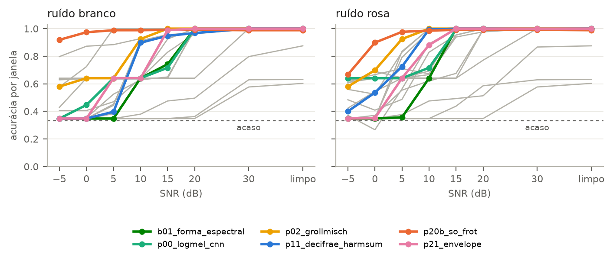
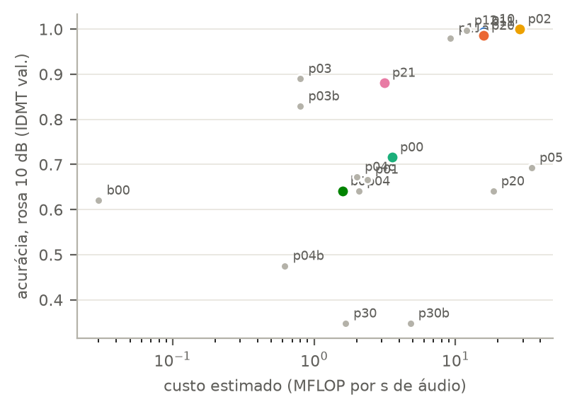

# MotorSound — estado de motores elétricos pelo som

Pesquisa que leva as técnicas de transcrição musical do [Decifrae](https://decifrae.com.br) (pYIN,
soma harmônica, Viterbi) para outro domínio: **identificar o estado de operação de motores
elétricos a partir do áudio**, com o objetivo final de embarcar o classificador num ESP32 como
monitor preventivo de baixo custo. É o terceiro artigo do Decifrae, escrito para o IEEE ICIT 2027.



## O que o projeto faz

- **25 pipelines comparadas no mesmo protocolo:** linhas de base simples (RMS e pico, forma
  espectral), reimplementações de trabalhos da literatura (CNNs com log-mel e MFCC, ETNeXt,
  features clássicas) e as pipelines Decifrae (rastreador de rotação por soma harmônica, pYIN e
  Viterbi, decodificação de estados com HMM).
- **Auditoria de vazamento:** cada pipeline roda com o split aleatório usado na literatura e com
  splits por gravação e por motor, para medir quanto da acurácia vem do split.
- **Robustez a ruído:** treino limpo e validação com ruído branco, rosa, percussivo, reverberação
  e desafinação, em várias SNRs.
- **Custo embarcado:** estimativa de MFLOP por segundo de áudio e de memória de cada pipeline.

## Resultados principais

Medidos só na validação das bases IDMT-ISA-ELECTRIC-ENGINE e BLDC A2212:

- **As bases públicas medem menos do que parece.** No IDMT cada classe é um motor gravado numa
  sessão só, e dois números (RMS e pico) bastam para 99 % na validação. No A2212 o split aleatório
  infla a acurácia em até 18 pontos, e deixar um motor de fora derruba os métodos para 0,33–0,78.
  Os trabalhos que reportam 96–100 % nessas bases usam o split que infla.
- **O rastreador de rotação vindo do transcritor de baixo funciona:** acerta a rotação sintética
  com erro abaixo de 0,1 % e é a feature mais robusta ao ruído da comparação, a única acima de
  0,9 com ruído branco a 0 dB.
- **A pipeline Decifrae completa não supera a literatura:** fica cerca de 20 pontos atrás das CNNs
  e das features clássicas no A2212. A contribuição é a feature robusta e barata, não a pipeline
  inteira.



## Como rodar

Testado com Python 3.14. As bases não fazem parte do repositório: baixe a IDMT-ISA-ELECTRIC-ENGINE
e a base BLDC A2212 e coloque-as em `data/idmt/` e `data/a2212/BLDC_sound_data/`.

```bash
python -m venv .venv
.venv/Scripts/python -m pip install -r requirements.txt     # Linux/macOS: .venv/bin/python

# testes (os de split precisam das bases em data/)
.venv/Scripts/python -m pytest tests

# matriz de validação e auditoria de vazamento
.venv/Scripts/python experimentos/validacao.py --pipelines b00_nivel b01_forma_espectral p11_decifrae_harmsum

# robustez a ruído
.venv/Scripts/python experimentos/robustez.py --pipelines p11_decifrae_harmsum b01_forma_espectral --base idmt

# tabelas e figuras a partir dos CSVs de out/experiments/
.venv/Scripts/python experimentos/tabelas_resultados.py
.venv/Scripts/python experimentos/analise.py
```

## Estrutura

| Pasta | Conteúdo |
|---|---|
| `motorsound/` | núcleo: leitura das bases, splits sem vazamento, rotação, HMM, classificador, métricas, cache |
| `pipelines/` | as 25 pipelines (`b0x` linhas de base, `p0x` literatura, `p1x` Decifrae, `p2x` rotação e envelope, `p3x` anomalia) |
| `ruidos/` | bateria de ruídos (branco, rosa, Lee & Shen) e sinais sintéticos |
| `experimentos/` | validação, robustez, sequências, estatística, tacômetro, tabelas |
| `artigo-2027/` | scripts da auditoria de mais seis bases públicas (KAIST, UOEMD, MIMII, ToyCar, IMVACD, MaFaulDa) para o artigo completo |
| `Embarcado/` | primeiro porte em C do núcleo de features |
| `out/` | resultados dos experimentos (CSVs comprimidos) e figuras |

O porte completo para o ESP32 (C em float e double, testes de equivalência com o Python, firmware
ESP-IDF e medições de latência e memória na placa) está na branch
[`embarcado-icit`](../../tree/embarcado-icit), em `embarcados/`.

## Autores

[ErickSebba](https://github.com/ErickSebba) e [DmZ-git](https://github.com/DmZ-git) (porte em C).
